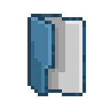
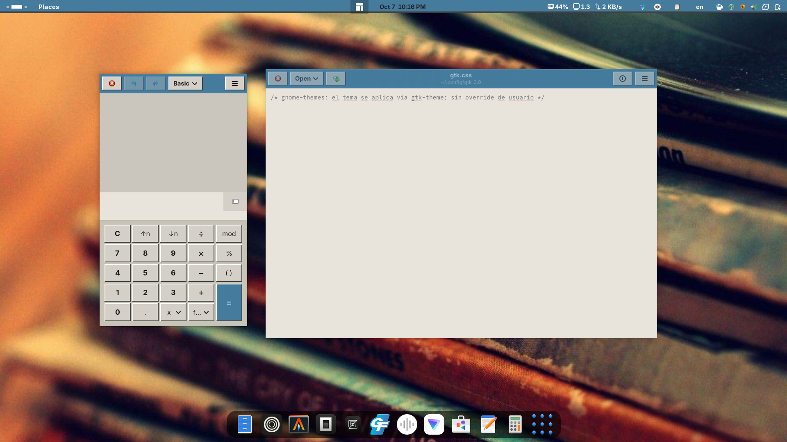

# gnome-themes



Colección de temas **GTK / GNOME** propios con dos estéticas:

- **retro**: bisel 3D de 2 px, esquinas rectas y paleta beige con acento azul.
- **minimal**: flat, esquinas de 6 px, casi monocromo (grises neutros) y relieve
  suave. Hay versión **sólida** y **translúcida**.

Todos incluyen **GTK3**, **GTK4/libadwaita** y **GNOME Shell**, con variante
clara y oscura. En GTK4 el modo oscuro sigue automáticamente al sistema.

Probado en **GNOME Shell 50.5 / GTK 4.22 (libadwaita)**.

## Vista previa

| Escritorio · Nautilus + Calendario | Apps GTK3 · calculadora + editor |
|:---:|:---:|
|  |  |

> Capturas de `retro-001`. La variante minimal es monocroma, con esquinas de
> 6 px y relieve suave.

## Temas

| Tema | Estilo | GTK3 | GTK4 | Shell | Estado |
|------|--------|:----:|:----:|:-----:|--------|
| [`retro-001`](retro/retro-001/) | Retro OS · bisel 3D · beige + acento azul | ✅ | ✅ | ✅ clara | usable |
| [`retro-001-dark`](retro/retro-001-dark/) | Solo Shell · variante oscura de `retro-001` | — | — | ✅ oscura | usable |
| [`minimal-001`](minimal/minimal-001/) | Minimal sólido · flat 6 px · monocromo + relieve suave | ✅ | ✅ | ✅ clara | usable |
| [`minimal-001-dark`](minimal/minimal-001-dark/) | Solo Shell · variante oscura de `minimal-001` | — | — | ✅ oscura | usable |
| [`minimal-001-transparent`](minimal/minimal-001-transparent/) | Minimal translúcido · shell glass + GTK con alpha | ✅ | ✅ | ✅ clara | usable |
| [`minimal-001-transparent-dark`](minimal/minimal-001-transparent-dark/) | Solo Shell · variante oscura translúcida | — | — | ✅ oscura | usable |

> `Orchis/` (gitignored) es una dependencia de terceros, **no** es un tema propio.

## Requisitos

- **GNOME** (probado en Shell 50.5) con GTK 4.22 / libadwaita.
- `gsettings` — para setear el tema GTK3 (si falta, el instalador avisa y seguís
  por Tweaks).
- `git` — solo para clonar. El instalador funciona igual sobre un ZIP.
- `tar` y `zip` — solo si vas a usar `pack.sh`.
- `python3` + `gresource` — solo para regenerar los CSS del Shell con
  `minimal/build-shell.py`.
- Extensión **User Themes** — solo para el tema de GNOME Shell.
- `stk` — el instalador usa el binario **vendoreado** `./stk` (v0.2.1-alpha);
  no hace falta instalarlo aparte.

## Instalar

```bash
git clone https://github.com/SpicyDogWings/gnome-themes.git
cd gnome-themes
chmod +x install.sh pack.sh stk        # solo si bajaste un ZIP
./install.sh minimal/minimal-001       # minimal sólido
```

`install.sh` acepta rutas o ids de tema y, si el tema tiene una entrada
`<id>-dark` (solo-shell), **la instala también** para que el symlink no quede
roto. Ejemplos:

```bash
./install.sh                             # todas las entradas; GTK = minimal-001
./install.sh minimal/minimal-001         # minimal sólido + shell oscura
./install.sh retro/retro-001             # retro + shell oscura
./install.sh minimal/minimal-001-transparent
```

Sin argumentos instala **todas** las entradas de Shell y usa
`minimal/minimal-001` como tema GTK por defecto. Podés cambiarlo con la variable
`DEFAULT_THEME`:

```bash
DEFAULT_THEME=retro/retro-001 ./install.sh
```

> **Ojo — un solo override GTK4.** El override de GTK4 es **un archivo**
> (`~/.config/gtk-4.0/gtk.css`). No pueden estar activos dos temas GTK4 a la
> vez. El instalador aplica el tema elegido (o `DEFAULT_THEME` en modo "todos");
> las demás entradas quedan instaladas solo para el Shell. El **Shell** sí
> convive: se elige cualquiera de las entradas en Tweaks.

`install.sh` hace, en el usuario actual:

1. **Copia cada tema** a `~/.local/share/themes/<id>` (ahí lo lee GTK3 y el
   selector de temas).
2. **Instala el override GTK4** del tema activo en `~/.config/gtk-4.0/gtk.css`,
   con backup del actual como `gtk.css.bak.<fecha>` (si ya es el del tema, no
   genera backup).
3. **Setea el tema GTK3** con
   `gsettings set org.gnome.desktop.interface gtk-theme <id>`
   (o elegilo en *Tweaks → Apariencia → Legacy Applications*).
4. **Neutraliza el override de usuario de GTK3** (`~/.config/gtk-3.0/gtk.css`),
   que si no pisa al tema. Guarda backup como `gtk.css.bak.<fecha>`.

Después, reiniciá las apps GTK (Nautilus, etc.) para ver los cambios. Para el
tema de Shell, cerrá sesión y volvé a entrar.

## Modo oscuro (automático en GTK4)

El override GTK4 trae la variante clara por defecto y un bloque
`@media (prefers-color-scheme: dark)` que redefine solo las claves que cambian.
Se activa solo al poner GNOME en oscuro:

```bash
gsettings set org.gnome.desktop.interface color-scheme prefer-dark   # oscuro
gsettings set org.gnome.desktop.interface color-scheme default       # claro
```

GTK3 **no** sigue ese setting: usa `gtk-application-prefer-dark-theme`, que toma
la variante `gtk-dark.css` del tema.

## Shell de GNOME

Tweaks lista **un tema de Shell por carpeta** y el motor CSS del Shell
(St/libcroco) **no** soporta `@media` ni `@define-color`, así que no se puede
tener claro+oscuro en un solo archivo. Por eso cada variante es un archivo y las
entradas `-dark` son **solo-shell** (un symlink al `gnome-shell-dark.css` del
tema completo):

| Carpeta | Shell |
|---------|-------|
| `retro/retro-001/` | clara · retro |
| `retro/retro-001-dark/` | oscura · retro |
| `minimal/minimal-001/` | clara · sólida |
| `minimal/minimal-001-dark/` | oscura · sólida |
| `minimal/minimal-001-transparent/` | clara · translúcida |
| `minimal/minimal-001-transparent-dark/` | oscura · translúcida |

Requiere la extensión **User Themes** habilitada. Elegí el tema en
**Tweaks → Apariencia → Shell**. O por comando:

```bash
EXT="$HOME/.local/share/gnome-shell/extensions/user-theme@gnome-shell-extensions.gcampax.github.com"
GSETTINGS_SCHEMA_DIR="$EXT/schemas" \
  gsettings set org.gnome.shell.extensions.user-theme name minimal-001-dark
```

Cambiá el nombre por `retro-001-dark`, `minimal-001`, etc. Cerrá sesión para ver
el cambio.

### Regenerar el Shell de minimal

Los `gnome-shell.css` de minimal se generan con `minimal/build-shell.py`, que
extrae el base del `gnome-shell-theme.gresource`, fuerza radio de 6 px, hornea el
acento del sistema a gris y agrega los overrides (sólida + transparente):

```bash
./minimal/build-shell.py
```

## Empaquetar (distribuir)

```bash
./pack.sh                 # todos los temas -> dist/<id>.zip y dist/<id>.tar.gz
./pack.sh retro/retro-001 # solo esos
```

Cada paquete lleva la **carpeta del tema en la raíz** y los **symlinks resueltos**
(autocontenido), así que se puede descomprimir directo en
`~/.local/share/themes/`. `dist/` está en `.gitignore`.

## Revertir / desinstalar

```bash
# GTK3: volver al tema por defecto
gsettings set org.gnome.desktop.interface gtk-theme Adwaita

# GTK4: borrar el override (vuelve libadwaita por defecto)
rm -f ~/.config/gtk-4.0/gtk.css
# o restaurar el backup:
ls ~/.config/gtk-4.0/gtk.css.bak.*
```

Para el Shell, elegí **Default** en *Tweaks → Apariencia → Shell* (o poné el
nombre del tema en vacío). Para borrar los temas instalados:

```bash
rm -rf ~/.local/share/themes/retro-001 \
       ~/.local/share/themes/retro-001-dark \
       ~/.local/share/themes/minimal-001 \
       ~/.local/share/themes/minimal-001-dark \
       ~/.local/share/themes/minimal-001-transparent \
       ~/.local/share/themes/minimal-001-transparent-dark
```

## Estructura

```
gnome-themes/
├── install.sh               # instalador (temas + override GTK4 + override GTK3 + gsettings)
├── pack.sh                  # empaqueta los temas en dist/ (.zip / .tar.gz)
├── stk                      # binario STK vendoreado (logging del instalador)
├── logo.png                 # logo del proyecto
├── LICENSE                  # MIT
├── preview/                 # capturas usadas en este README
│   ├── screen1.png
│   └── screen2.png
├── Orchis/                  # (gitignored) dependencia de terceros
├── retro/
│   ├── retro-001/           # tema completo (GTK3 + GTK4 + shell clara)
│   │   ├── index.theme      # "ficha" del tema
│   │   ├── README.md        # detalle del tema y guía de instalación
│   │   ├── gtk-3.0/         # tema GTK3 (palette.css + reglas + variante dark)
│   │   ├── gtk-4.0/         # override GTK4/libadwaita (claro + dark automático)
│   │   └── gnome-shell/     # tema de Shell (clara/oscura)
│   └── retro-001-dark/      # solo shell oscura (entrada aparte en Tweaks)
│       ├── index.theme
│       └── gnome-shell/gnome-shell.css -> ../../retro-001/gnome-shell/gnome-shell-dark.css
└── minimal/
    ├── build-shell.py       # genera los gnome-shell.css (sólida + transparente)
    ├── minimal-001/         # tema completo SÓLIDO (GTK3 + GTK4 + shell clara)
    │   ├── index.theme
    │   ├── README.md
    │   ├── gtk-3.0/
    │   ├── gtk-4.0/
    │   └── gnome-shell/
    ├── minimal-001-dark/    # solo shell oscura (entrada aparte en Tweaks)
    │   ├── index.theme
    │   └── gnome-shell/gnome-shell.css -> ../../minimal-001/gnome-shell/gnome-shell-dark.css
    ├── minimal-001-transparent/   # tema completo TRANSLÚCIDO
    │   ├── index.theme
    │   ├── README.md
    │   ├── gtk-3.0/
    │   ├── gtk-4.0/
    │   └── gnome-shell/
    └── minimal-001-transparent-dark/  # solo shell oscura translúcida
        ├── index.theme
        └── gnome-shell/gnome-shell.css -> ../../minimal-001-transparent/gnome-shell/gnome-shell-dark.css
```

## Notas y limitaciones

- Cada tema es autocontenido en su carpeta: `index.theme` + `gtk-3.0/` + `gtk-4.0/`
  (+ `gnome-shell/` si trae Shell).
- En GNOME, las apps GTK4 usan **libadwaita** y **no** leen
  `~/.local/share/themes`; la vía confiable para reestilarlas es el **override
  de usuario** `~/.config/gtk-4.0/gtk.css`.
- El tema cubre GTK3, GTK4 y Shell. **No** incluye iconos, cursores ni
  decoración de ventanas: `index.theme` cae a Adwaita para esos.
- La variante **transparente** depende del soporte de ventanas con alpha de cada
  app; no todas la respetan. El Shell sí usa gradientes `rgba` (glass).
- El CSS del Shell se edita al final de los `gnome-shell-<light|dark>.css`
  (bloque "SHELL OVERRIDES"); los colores van literales porque St no soporta
  `@define-color`. En minimal, regenerá con `./minimal/build-shell.py`.
- Los backups del instalador (`*.bak.<fecha>`) no se limpian solos; podés
  borrarlos cuando confirmes que el tema funciona.
