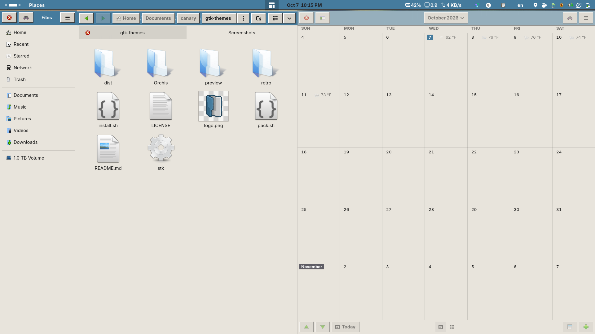

# retro-001

Tema propio con estética **Retro OS**: bisel 3D de 2 px, esquinas rectas y
paleta beige + acento azul. Incluye **GTK3**, **GTK4/libadwaita** y **GNOME
Shell** (clara y oscura).



## Estado

| Componente | Estado |
|------------|--------|
| GTK3 | ✅ aplicado vía `gtk-theme` (con variante `gtk-dark.css`) |
| GTK4 / libadwaita | ✅ override de usuario, claro + dark automático |
| GNOME Shell | ✅ entrada clara y entrada oscura |

## Instalación

### Requisitos

- GNOME (probado en **Shell 50.5 / GTK 4.22**).
- `gsettings` para setear el tema GTK3.
- `stk` vendoreado en la raíz del repo (`./stk`, v0.2.1-alpha). No se instala
  aparte.
- Extensión **User Themes** habilitada, solo para el Shell.
- `tar` / `zip`, solo si vas a empaquetar con `pack.sh`.

### Instalar desde el repo

```bash
git clone https://github.com/SpicyDogWings/gnome-themes.git
cd gnome-themes
chmod +x install.sh pack.sh stk        # solo si bajaste un ZIP
./install.sh retro/retro-001
```

El instalador agrega solo la entrada `retro-001-dark` (shell oscura) cuando
existe. `./install.sh` sin argumentos instala todas las entradas y usa
`minimal/minimal-001` como tema GTK por defecto; para retro usá
`DEFAULT_THEME=retro/retro-001 ./install.sh`.

> La **shell oscura** vive en `retro-001-dark/` y su
> `gnome-shell/gnome-shell.css` es un symlink a
> `../../retro-001/gnome-shell/gnome-shell-dark.css`. Si copiás las carpetas a
> mano, instalá las dos para que el enlace no quede roto.

### Qué hace el instalador

1. Copia el tema a `~/.local/share/themes/<id>` (lo lee GTK3 y el selector de
   temas).
2. Copia `gtk-4.0/gtk.css` a `~/.config/gtk-4.0/gtk.css` (override GTK4), con
   backup del actual como `gtk.css.bak.<fecha>` si es distinto.
3. Setea `org.gnome.desktop.interface gtk-theme` con el id del tema.
4. Neutraliza el override de usuario `~/.config/gtk-3.0/gtk.css` (con backup),
   porque si importa otra paleta pisa al tema.

Después reiniciá las apps GTK y, para el Shell, cerrá sesión y volvé a entrar.

### Revertir

```bash
# GTK3
gsettings set org.gnome.desktop.interface gtk-theme Adwaita

# GTK4
rm -f ~/.config/gtk-4.0/gtk.css        # o restaurá ~/.config/gtk-4.0/gtk.css.bak.*
```

Para el Shell, elegí **Default** en *Tweaks → Apariencia → Shell*.

## Estructura

```
gnome-themes/                        # repo
├── install.sh                       # instalador
├── pack.sh                          # empaquetado en dist/
├── stk                              # binario STK vendoreado (logging)
├── preview/                         # capturas
└── retro/retro-001/                 # el tema
    ├── index.theme                  # "ficha" del tema
    ├── README.md
    ├── gtk-3.0/
    │   ├── palette.css              # paleta clara (fuente única) + alias
    │   ├── palette-dark.css         # paleta oscura
    │   ├── rules.css                # reglas retro (bisel 2 px, esquinas rectas)
    │   ├── gtk.css                  # @import Adwaita claro + palette + rules
    │   └── gtk-dark.css             # @import Adwaita dark + palette-dark + rules
    ├── gtk-4.0/
    │   └── gtk.css                  # GTK4/libadwaita: claro + dark automático
    └── gnome-shell/
        ├── gnome-shell.css          # symlink a gnome-shell-light.css
        ├── gnome-shell-light.css    # base del shell + overrides retro (clara)
        └── gnome-shell-dark.css     # base del shell + overrides retro (oscura)
```

## GTK3

Tema retro completo: base Adwaita + paleta propia + reglas (bisel 3D de 2 px,
esquinas rectas, titlebar en acento). Dos variantes:

- `gtk.css` → **clara** (base Adwaita claro + `palette.css` + `rules.css`)
- `gtk-dark.css` → **oscura** (base Adwaita dark + `palette-dark.css` + `rules.css`)

GTK3 elige la variante con `gtk-application-prefer-dark-theme` (no sigue el
`color-scheme` del sistema como GTK4).

- `./install.sh retro/retro-001` copia el tema a
  `~/.local/share/themes/retro-001` y setea `gtk-theme` con gsettings (o
  elegilo en Tweaks → Apariencia → Legacy Applications).
- El **override de usuario** `~/.config/gtk-3.0/gtk.css` pisa al tema. El
  instalador lo deja neutralizado (backup en `gtk.css.bak.<fecha>`).

### Hot reload (verificado)

GTK3 relee los archivos si recreás el tema por nombre:

```bash
gsettings set org.gnome.desktop.interface gtk-theme Adwaita
gsettings set org.gnome.desktop.interface gtk-theme retro-001
```

## GTK4 / libadwaita

En GNOME 50 las apps GTK4 usan **libadwaita**, que **no** lee temas de
`~/.local/share/themes`. La única vía real es un override de usuario:

```
~/.config/gtk-4.0/gtk.css
```

`gtk-4.0/gtk.css` está pensado justo para eso (archivo único, autocontenido).

`./install.sh retro/retro-001` lo copia a `~/.config/gtk-4.0/gtk.css`, con
backup del actual como `gtk.css.bak.<fecha>` si es distinto. Revertir:
restaurar el backup o borrar el archivo.

### Variante dark (automática)

El mismo `gtk-4.0/gtk.css` trae las dos variantes: la paleta clara por defecto
y un bloque `@media (prefers-color-scheme: dark)` que **redefine solo las
claves que cambian** (`bg`, `fg`, `base`, `surface`, `border`, `bevel_light`,
`bevel_dark`, `hover`, `insensitive_fg_color`). `@accent` queda igual, así que
**una sola clave sigue mandando sobre todo el azul**.

GTK enlaza `prefers-color-scheme` de este provider al `color-scheme` del
sistema, así que la variante dark **se activa sola** al poner GNOME en modo
oscuro (no hay que cambiar archivos ni symlinks):

```bash
gsettings set org.gnome.desktop.interface color-scheme prefer-dark   # dark
gsettings set org.gnome.desktop.interface color-scheme default       # claro
```

## GNOME Shell

El tema de shell viene en **dos variantes** (St/libcroco **no** soporta
`@media` ni `@define-color`, así que no se pueden tener claro+oscuro en un solo
archivo):

- `gnome-shell/gnome-shell-light.css` → base del shell + overrides retro (clara)
- `gnome-shell/gnome-shell-dark.css` → ídem (oscura)
- `gnome-shell/gnome-shell.css` → **symlink** a la clara (variante activa)

Para que Tweaks liste la variante oscura como una entrada aparte, existe el tema
`retro-001-dark/` (solo-shell) cuyo `gnome-shell/gnome-shell.css` apunta acá:
`retro-001-dark/gnome-shell/gnome-shell.css -> ../../retro-001/gnome-shell/gnome-shell-dark.css`.

El `border-radius` del base está forzado a `0` (esquinas rectas). Los overrides
(con la paleta literal) van al final de cada archivo.

Necesita la extensión **User Themes** habilitada. Activar (Tweaks → Apariencia →
Shell, o):

```bash
EXT="$HOME/.local/share/gnome-shell/extensions/user-theme@gnome-shell-extensions.gcampax.github.com"
GSETTINGS_SCHEMA_DIR="$EXT/schemas" \
  gsettings set org.gnome.shell.extensions.user-theme name retro-001
```

Cambiá `retro-001` por `retro-001-dark` para la shell oscura. Cerrá sesión para
ver el cambio.

Regenerar el base tras un update del shell (y volver a forzar `border-radius: 0`):

```bash
gresource extract /usr/share/gnome-shell/gnome-shell-theme.gresource \
  /org/gnome/shell/theme/gnome-shell-light.css   # o -dark.css
```

## Distribuir

Desde la raíz del repo:

```bash
./pack.sh retro/retro-001 retro/retro-001-dark
```

Genera `dist/<id>.zip` y `dist/<id>.tar.gz` con la carpeta del tema en la raíz y
los symlinks resueltos (autocontenido). El ZIP se puede descomprimir directo en
`~/.local/share/themes/`.

## Problemas comunes

| Síntoma | Causa / solución |
|---------|------------------|
| `install.sh: Permission denied` | `chmod +x install.sh pack.sh stk` |
| La shell oscura no aparece en Tweaks | Falta instalar `retro-001-dark` (instalá las dos carpetas) |
| `gsettings: no such schema ... user-theme` | La extensión User Themes no está instalada/habilitada |
| Cambios de GTK que no se ven | Reiniciá la app; para GTK3 usá el hot reload de arriba |
| El tema GTK3 no se aplica | Revisá que `~/.config/gtk-3.0/gtk.css` esté neutralizado |
| GTK4 sigue con el estilo de Adwaita | Verificá que exista `~/.config/gtk-4.0/gtk.css` |

## Notas

- GTK4 se edita en `gtk-4.0/gtk.css` (colores con nombres libadwaita).
- El tema de Shell se edita al final de `gnome-shell/gnome-shell-light.css` y
  `gnome-shell-dark.css` (bloque "OVERRIDES").
- El tema no incluye iconos, cursores ni decoración de ventanas: `index.theme`
  usa Adwaita para esos.
